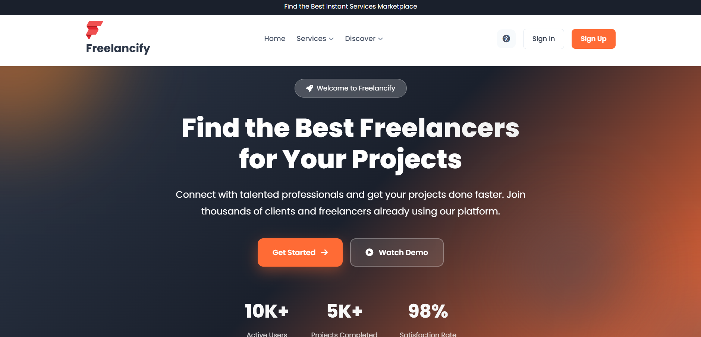
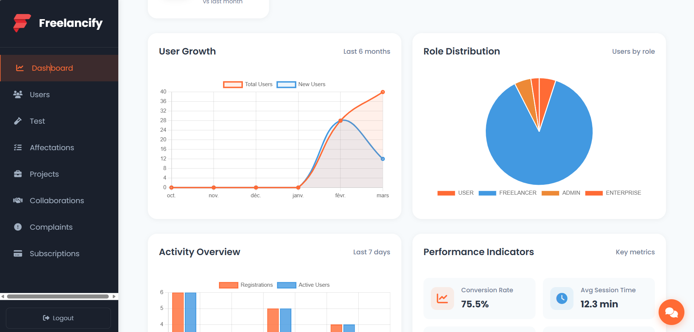
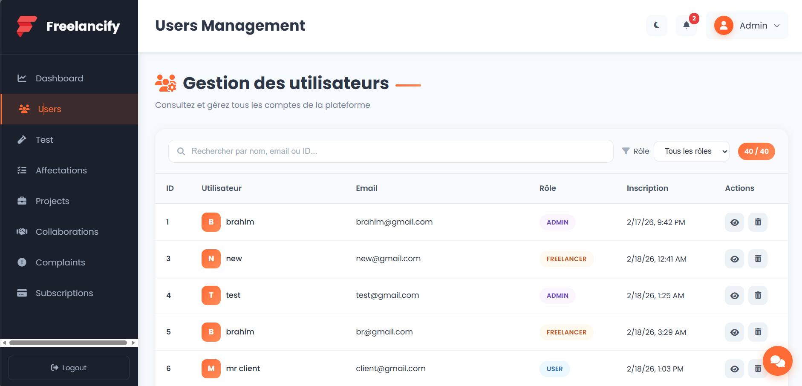
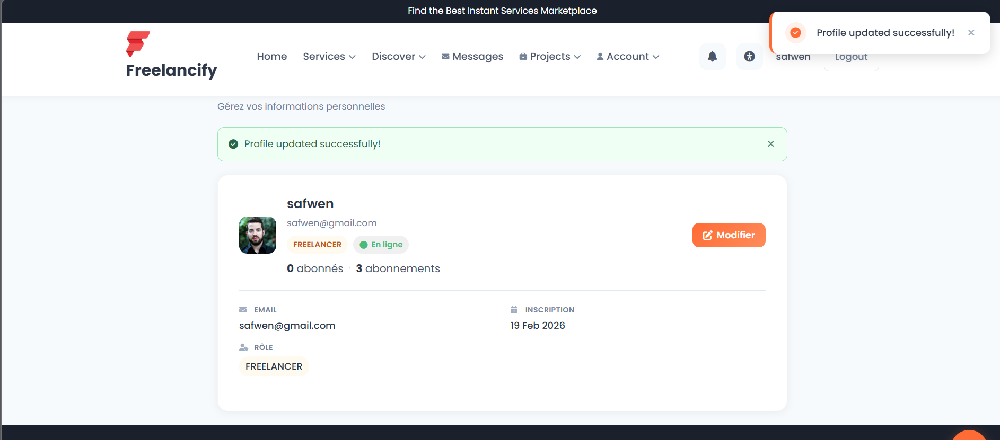
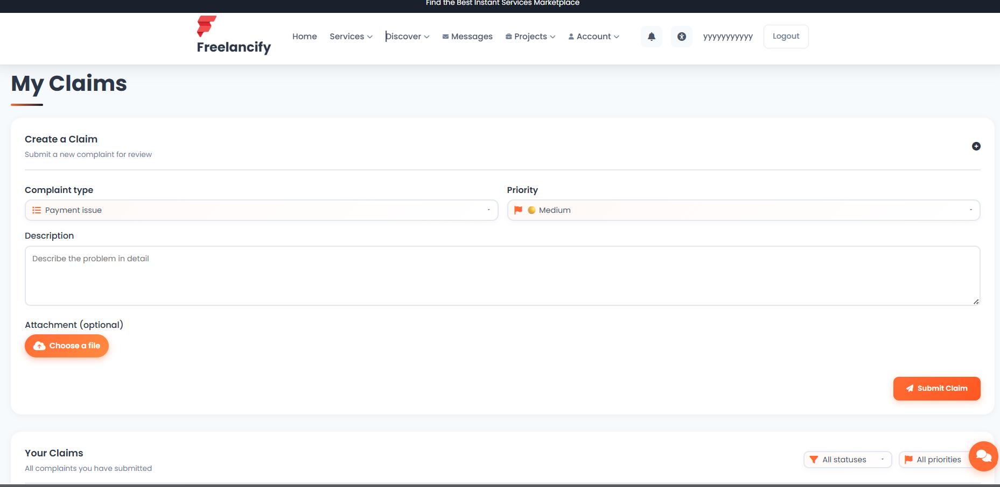
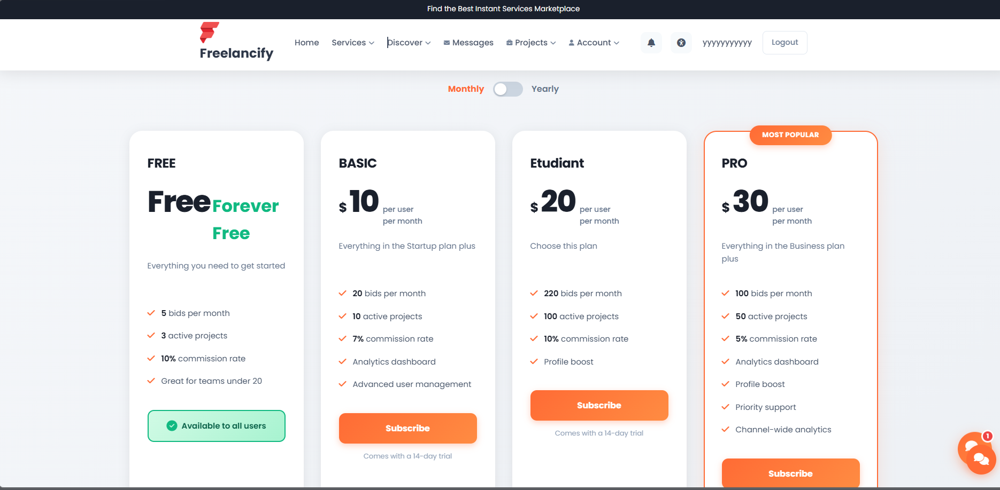

<div align="center">

<table width="100%" border="0" cellspacing="0" cellpadding="0">
<tr>
<td align="left" width="120">
  
</td>
<td align="center">

# 🚀 Freelance Management Platform

**Microservices Architecture — Connect clients & freelancers**

[](https://openjdk.org/)
[](https://angular.io/)
[](https://spring.io/)
[](https://symfony.com/)
[](https://www.keycloak.org/)
[](https://www.mysql.com/)
[](https://www.postgresql.org/)
[](https://spring.io/projects/spring-cloud-config)

</td>
<td align="right" width="120">
  
</td>
</tr>
</table>

</div>

---

## 📌 Overview

A **Freelance Management Platform** built with a **microservices architecture**, enabling clients and freelancers to collaborate through dedicated services. All traffic goes through an **API Gateway**; authentication is handled by **Keycloak** (OAuth2 / JWT).

| Domain | Description |
|--------|--------------|
| 📝 **Posts** | Publish and manage posts (clients & freelancers) |
| 🧪 **Tests** | Technical tests and evaluations |
| 💳 **Payments** | Payments and transactions |
| 📋 **Complaints** | User complaints and support (reclamations) |
| 📁 **Projects** | Freelance projects and assignments |
| 🤝 **Collaboration** | Advanced collaboration (Symfony API + **PostgreSQL**) |

- **Backend:** Spring Boot microservices behind an **API Gateway**, **Eureka** discovery, optional **Spring Cloud Config Server** (port `8987`, registered in Eureka), plus **Symfony** for collaboration (HTTP route from the gateway, not on Eureka)
- **Frontend:** Angular SPA
- **Auth:** Keycloak (login, roles, JWT)
- **Data:** **MySQL** for Spring microservices; **PostgreSQL** for the collaboration service

---

## ✨ Features

| Domain | Features |
|--------|----------|
| **Users** | Registration, profile, roles (Admin, Client, Freelancer), Keycloak sync, messaging, follow, ratings, posts, notifications |
| **Projects** | CRUD projects, proposals, tasks, statistics, filters by status/category |
| **Collaboration** | Collaboration requests, workspace (tasks, sprints, milestones), teams — **Symfony** + **PostgreSQL** |
| **Complaints** | Claim submission, attachments, admin workflow, penalties |
| **Subscriptions** | Plans (e.g. FREE, BASIC, PRO), create/cancel subscription, payment webhooks, admin analytics |
| **Tests** | Technical tests (QCM, coding), assignments, code execution, face verification |
| **Admin** | Dashboard, user/project/complaint/subscription management, statistics |

---

## ⚙️ Tech Stack

<table>
<tr>
<td width="33%">

**Backend**
- Java 17+
- Spring Boot
- Spring Cloud Gateway
- Spring Cloud Netflix Eureka
- Spring Cloud Config Server (optional)
- Spring Security / OAuth2 Resource Server
- Keycloak
- Symfony (PHP) + Doctrine

</td>
<td width="33%">

**Frontend**
- Angular
- TypeScript
- Bootstrap / Material UI

</td>
<td width="33%">

**Data & tools**
- MySQL (Spring services)
- PostgreSQL (collaboration)
- REST APIs
- Maven, Docker Compose

</td>
</tr>
</table>

---

## 🏗️ Architecture

```
┌─────────────┐     ┌─────────────┐     ┌─────────────────┐     ┌──────────────────────────┐     ┌────────────────┐
│   Client    │────▶│   Angular   │────▶│   API Gateway   │────▶│  Spring microservices     │────▶│  MySQL         │
│   (User)    │     │  Frontend   │     │  (single entry) │     │  (Eureka) + Config :8987  │     │  (Spring data) │
└─────────────┘     └─────────────┘     └────────┬────────┘     └──────────────────────────┘     └────────────────┘
                                                 │
                                                 │  HTTP direct (Symfony, not on Eureka)
                                                 ▼
                                        ┌─────────────────┐     ┌────────────────┐
                                        │  Collaboration  │────▶│  PostgreSQL    │
                                        │  (Symfony)      │     │  (collab DB)   │
                                        └─────────────────┘     └────────────────┘
```

| Service | Role |
|---------|------|
| **Eureka Server** | Service discovery for Spring Cloud services |
| **Config Server** | Centralized configuration (`native`, `classpath:/config/`), Eureka client, port **8987** |
| **API Gateway** | Single entry, routing, CORS (`ApiGateway4sae2`) |
| **User Service** | User management, secured with Keycloak (`user-service`) |
| **Project Service** | Projects, proposals, tasks (`project-service`) |
| **Complaints Service** | Complaints, penalties, related APIs (`freelance-platform-spring-app`) |
| **Service Test** | Technical tests and evaluations (`service-test`) |
| **Collaboration Service** | Advanced collaboration — **Symfony** + **PostgreSQL** (`services/collaborationService`) |

> **Note:** Posts, payments, and subscriptions are implemented as features across the platform (users, complaints, gateway routes); there is no separate “Post microservice” or “Payment microservice” in this repository.

---

## ☁️ Spring Cloud Config (optional)

Clients can pull config from the server with:

```properties
spring.cloud.config.enabled=true
spring.config.import=optional:configserver:http://localhost:8987
```

Add **`spring-cloud-starter-config`** on the client classpath. Start order: **Eureka** → **Config Server** → other Spring services.

---

## 🔐 Authentication — Keycloak

| Feature | Description |
|---------|-------------|
| 🔒 **Login & registration** | Secure sign-up and sign-in |
| 👥 **Roles** | Admin, Client, Freelancer |
| 🎫 **JWT** | Token-based authentication |
| 🏠 **Identity** | Centralized user management |

---

## 📸 Screenshots

*Click on an image to open it in full size.*

<table>
<tr>
<td align="center" width="33%"><strong>Home / Login</strong><br><a href="docs/screenshots/home.png" target="_blank"></a></td>
<td align="center" width="33%"><strong>Dashboard</strong><br><a href="docs/screenshots/dashboard.png" target="_blank"></a></td>
<td align="center" width="33%"><strong>Users</strong><br><a href="docs/screenshots/users.png" target="_blank"></a></td>
</tr>
<tr>
<td align="center" width="33%"><strong>Profile</strong><br><a href="docs/screenshots/profile.png" target="_blank"></a></td>
<td align="center" width="33%"><strong>Complaints</strong><br><a href="docs/screenshots/compaints.png" target="_blank"></a></td>
<td align="center" width="33%"><strong>Subscriptions</strong><br><a href="docs/screenshots/subscriptions.png" target="_blank"></a></td>
</tr>
</table>

---

## 🎓 Academic Context

| | |
|--|--|
| **Institution** | Esprit School of Engineering - Tunisia |
| **Academic year** | 2025-2026 |
| **Context** | 2nd year Software Engineering cycle (4SAE2) |
| **Objectives** | Microservices (Spring Boot, Eureka, API Gateway, Config Server), modern frontend (Angular), security (Keycloak/OAuth2/JWT), collaboration on **Symfony/PostgreSQL**, integration of complaints, subscriptions, payments, and technical tests. |

---

## 🚀 Getting Started

### Prerequisites

- **JDK 17+**
- **Node.js 18+** and **npm**
- **MySQL** (local or remote) for Spring services
- **PostgreSQL** (for the Symfony collaboration service, e.g. port `5432` or `5434` with Docker)
- **Keycloak** (e.g. port `8080` local, or `8180` with Docker Compose) with realm and client configured
- **Maven 3.8+**

### Startup order

1. **MySQL** — Start the server; databases can be created on first run (`freelance_db`, `freelancify`, etc.).
2. **PostgreSQL** — For collaboration (`collaboration_db` when running Symfony).
3. **Keycloak** — Run Keycloak, configure realm and client (e.g. `projetpidev` / `freelance-client` per your `application.yml`).
4. **Eureka** — From project root: `cd Eureka` then `mvn spring-boot:run` (port **8761** locally).
5. **Config Server** *(optional)* — `cd config-server` then `mvn spring-boot:run` (port **8987**).
6. **API Gateway** — `cd ApiGateway4sae2` then `mvn spring-boot:run` (port **8090**).
7. **Microservices** — Start **user-service** (`services/backend1`), **project-service**, **complaints-service**, **service-test**, and **collaboration** (`services/collaborationService` / Symfony) as needed.
8. **Frontend** — `cd frontend`, `npm install`, `npm start` or `ng serve` (port **4200**).

### Docker Compose (full stack)

From the repository root:

```bash
docker compose up -d --build
```

Typical **host** ports: Eureka **18761**, MySQL **3307**, PostgreSQL **5434**, Keycloak **8180**, Gateway **18090**, Frontend **4200**, Collaboration **8888** — see comments in `docker-compose.yml`.

### Access

| Service | URL (local dev) |
|---------|-----------------|
| **Frontend** | http://localhost:4200 |
| **API Gateway** | http://localhost:8090 |
| **Eureka Dashboard** | http://localhost:8761 |
| **Config Server** | http://localhost:8987 |
| **Keycloak Admin** | http://localhost:8080 |

---

## 👥 Contributors

**Team Alpha** — Esprit School of Engineering - Tunisia, 2025-2026

| Member | Role |
|--------|------|
| **Mohamed Brahim Garram** | 🧪 Tests — assignments, code execution, face verification |
| **Sahem Omrane** | 📋 Projects — CRUD, proposals, tasks, statistics |
| **Adam Abidi** | 🤝 Collaboration — workspace, sprints, milestones, teams |
| **Safwen Souissi** | 📝 Complaints & subscriptions — plans, workflow, analytics |
| **Amira Ghobber** | 📝 Payment and Facturation |

---

<div align="center">

*Built with Spring Boot, Symfony & Angular — Microservices Architecture*

</div>
